

 

## 2026

  

    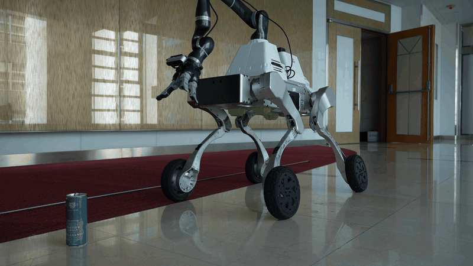
  

  

    
Online Learning of Heterogeneous Locomotion Dynamics under Reinforcement Learning Policies for Precise Loco-Manipulation

    

      Tianlin Zhang, Weipeng Xia, Lingwei Zhang, Yiyang Shao, Zhongyu Li, Yun-Hui Liu
    

    
arXiv preprint, arXiv:2610.41892, 2026

    

      <a href="https://arxiv.org/abs/2610.41892">arXiv</a>
    

  

  

    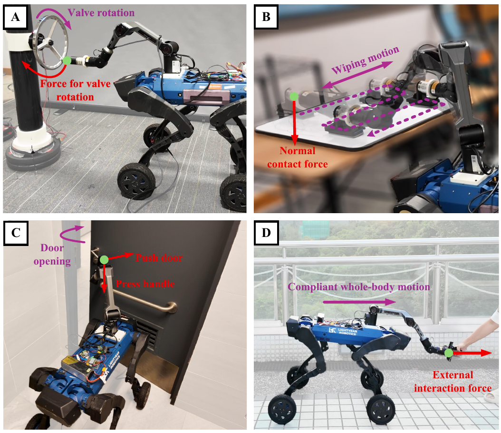
  

  

    
Force-Aware Reinforcement Learning with Hybrid Sensorless Force Estimation for Wheeled-Legged Loco-Manipulation

    

      Xuanqi Zeng, Jiaming Wang, Tianlin Zhang, Lingwei Zhang, Botian Xu, Weipeng Xia, Zhongyu Li, Yun-Hui Liu
    

    
arXiv preprint, arXiv:2609.13779, 2026

    

      <a href="https://arxiv.org/abs/2609.13779">arXiv</a>
    

  

  

    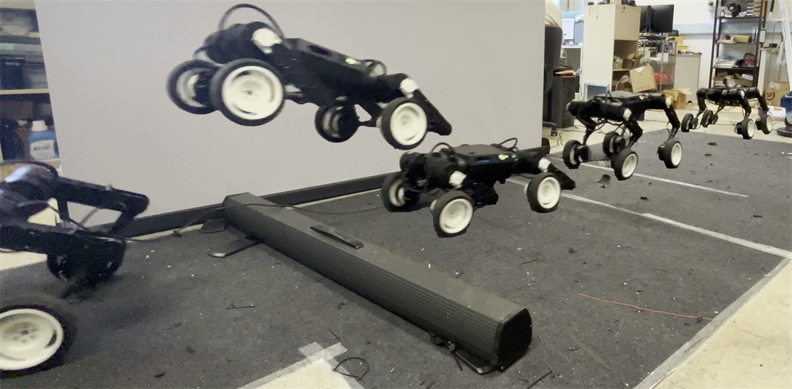
  

  

    
Jumping Control for a Quadrupedal Wheeled-Legged Robot via NMPC and DE Optimization

    

      Xuanqi Zeng, Lingwei Zhang, Linzhu Yue, Zhitao Song, Hongbo Zhang, Tianlin Zhang, Yun-Hui Liu
    

    
arXiv preprint, arXiv:2602.21612, 2026

    

      <a href="https://arxiv.org/abs/2602.21612">arXiv</a>
    

  

  

    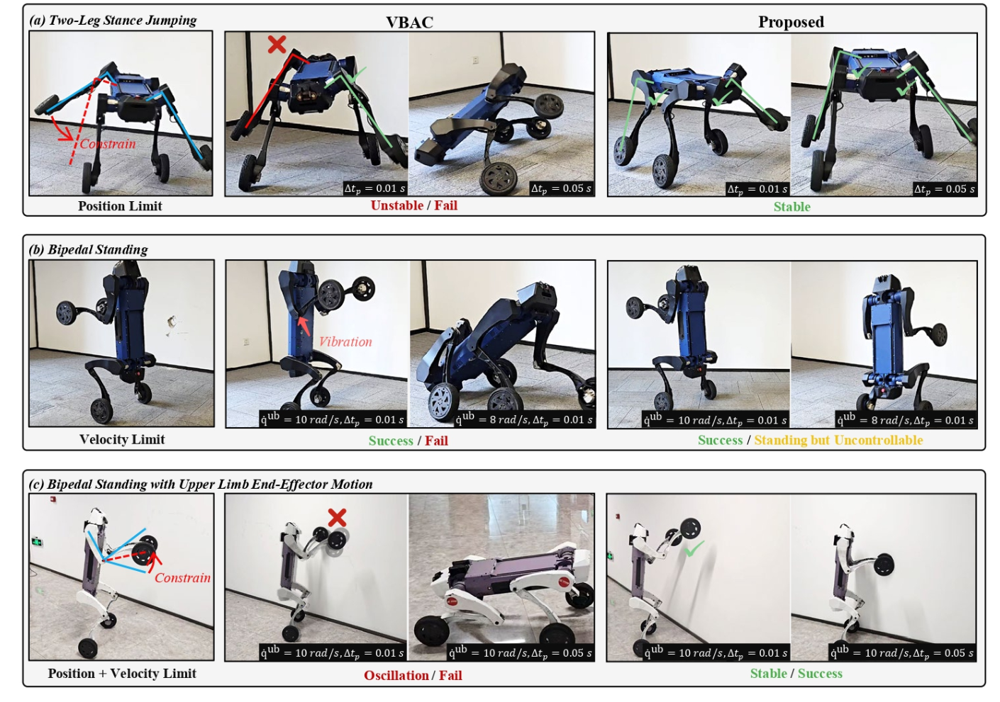
  

  

    
VRA: Grounding Discrete-Time Joint Acceleration in Voltage-Constrained Actuation 

    

      Lingwei Zhang, Jiaming Wang, Tianlin Zhang, Zhitao Song, Xuanqi Zeng, Weipeng Xia, Zhongyu Li, Yun-hui Liu
    

    
Robotics: Science and Systems (<b>RSS</b>), 2026

    

      <a href="https://arxiv.org/abs/2605.10696">arXiv</a> |
      <a href="https://zlwsss.github.io/VRA/">web</a>
    

  

  

    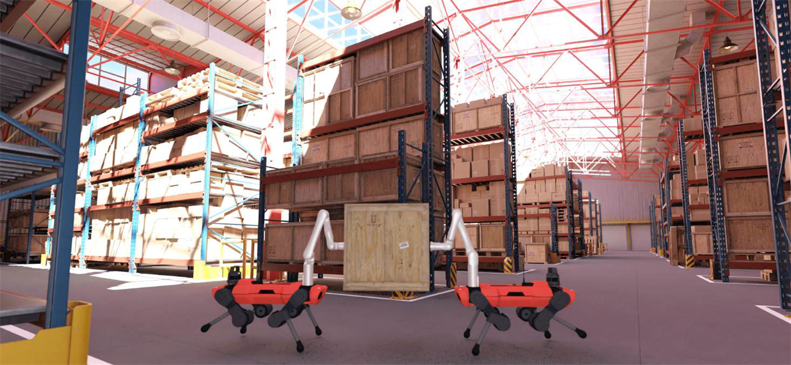
  

  

    
Shared Object Manipulation with a Team of Collaborative Quadrupeds

    

      Shengzhi Wang, Niels Dehio, Xuanqi Zeng, Xian Yang, Lingwei Zhang, Yun-Hui Liu, K. W. Samuel Au
    

    
American Control Conference (<b>ACC</b>), IEEE, 2026

    

      <a href="https://arxiv.org/abs/2510.00682">arXiv</a>
    

  

## 2025

  

    
  

  

    
Traversability-Aware Legged Navigation by Learning from Real-World Visual Data

    

      H. Zhang, Z. Li, X. Zeng, L. Smith, K. Stachowicz, … &amp; and Y. H. Liu
    

    
IEEE Transactions on Robotics (<b>T-RO</b>), 2025

    

      <a href="https://arxiv.org/abs/2410.10621">arXiv</a> |
      <a href="https://www.youtube.com/watch?v=RSqnIWZ1qks">video</a>
    

  

  

    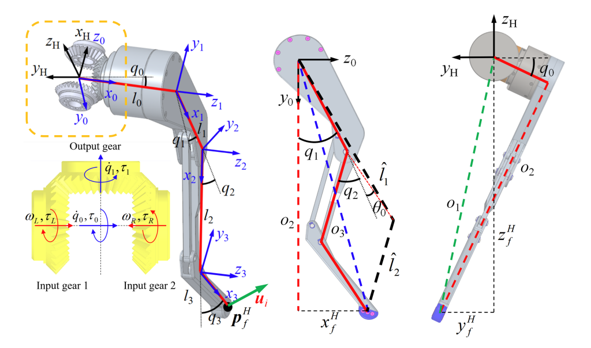
  

  

    
Codesign of a Differential Three-Segment Leg Enhancing Payload and Efficiency in Quadrupeds

    

      Z. Song, L. Yue, L. Zhang, X. Zeng, H. Zhang, J. Dong, … &amp; Y. H. Liu
    

    
IEEE/ASME Transactions on Mechatronics (<b>TMECH</b>), 2025

    

      <a href="https://ieeexplore.ieee.org/abstract/document/11130397">link</a>
    

  

  

    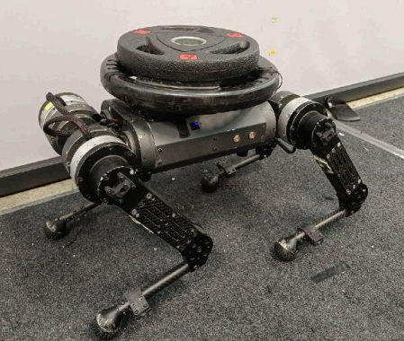
  

  

    

      Robust Model Predictive Control for Quadruped Locomotion Under Model Uncertainties and External Disturbances
    

    
W. Xia, L. Yue &amp; Y. H. Liu

    

      IEEE/RSJ International Conference on Intelligent Robots and Systems (<b>IROS</b>), 2025
    

    

      <a href="https://ieeexplore.ieee.org/document/11246673">link</a>
    

  

  

    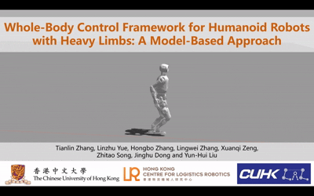
  

  

    

      Whole-Body Control Framework for Humanoid Robots with Heavy Limbs: A Model-Based Approach
    

    

      T. Zhang, L. Yue, H. Zhang, L. Zhang, X. Zeng, Z. Song, and Y. H. Liu
    

    

      <i>arXiv preprint</i>, arXiv:2506.14278, 2025
    

    

      <a href="https://arxiv.org/abs/2506.14278">arXiv</a> |
      <a href="https://www.youtube.com/watch?v=--KyvVvE7XM&amp;t=3s">video</a>
    

  

## 2024

  

    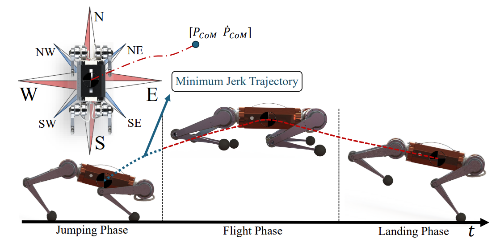
  

  

    

      A Fast Online Omnidirectional Quadrupedal Jumping Framework via Virtual-Model Control and Minimum Jerk Trajectory Generation
    

    

      L. Yue, L. Zhang, Z. Song, H. Zhang, J. Dong, X. Zeng, &amp; Y. H. Liu
    

    

      IEEE/RSJ International Conference on Intelligent Robots and Systems (<b>IROS</b>), 2024
    

    

      <a href="https://ieeexplore.ieee.org/abstract/document/10802277">link</a> |
      <a href="https://www.youtube.com/watch?v=BH0W5F8D1XI">video</a>
    

  

  

    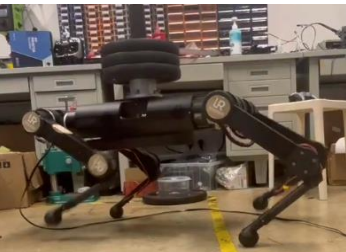
  

  

    

      Adaptive Model Predictive Control with Data-driven Error Model for Quadrupedal Locomotion
    

    

      X. Zeng, H. Zhang, L. Yue, Z. Song, L. Zhang, &amp; Y. H. Liu
    

    

      IEEE International Conference on Robotics and Automation (<b>ICRA</b>), 2024
    

    

      <a href="https://ieeexplore.ieee.org/abstract/document/10611302">link</a> |
      <a href="https://www.youtube.com/watch?v=T2YMT7QSnfA">video</a>
    

  

## 2023

  

    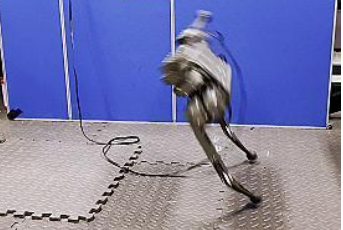
  

  

    

      Evolutionary-Based Online Motion Planning Framework for Quadruped Robot Jumping
    

    

      L. Yue, Z. Song, H. Zhang, X. Zeng, L. Zhang, &amp; Y. H. Liu
    

    

      IEEE/RSJ International Conference on Intelligent Robots and Systems (<b>IROS</b>), 2023
    

    

      <a href="https://ieeexplore.ieee.org/abstract/document/10342082">link</a> |
      <a href="https://www.youtube.com/watch?v=oDcqd7AUlD0&amp;t=31s">video</a>
    

  

  

    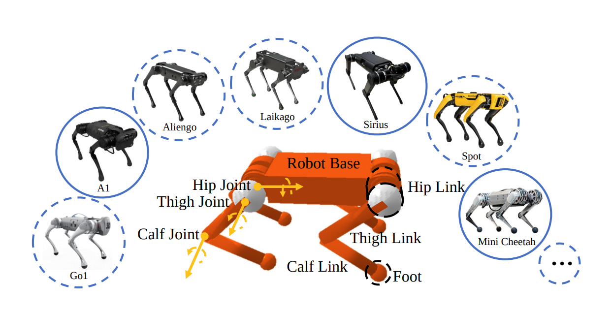
  

  

    

      GenLoco: Generalized Locomotion Controllers for Quadrupedal Robots
    

    

      G. Feng, H. Zhang, Z. Li, X. B. Peng, B. Basireddy, L. Yue, … &amp; S. Levine
    

    

      Conference on Robot Learning (<b>CoRL</b>), 2023
    

    

      <a href="https://proceedings.mlr.press/v205/feng23a.html">link</a> |
      <a href="https://www.youtube.com/watch?v=5QUs32MjNu4">video</a>
    

  

## 2022

  

    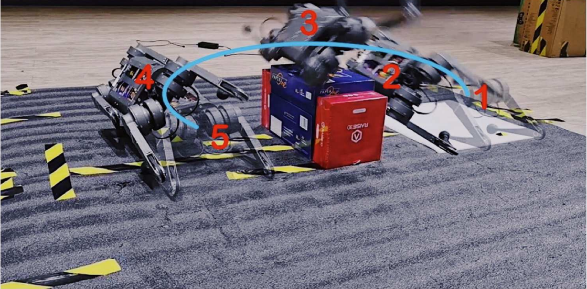
  

  

    

      An Optimal Motion Planning Framework for Quadruped Jumping
    

    

      Z. Song, L. Yue, G. Sun, Y. Ling, H. Wei, L. Gui, &amp; Y. H. Liu
    

    

      IEEE/RSJ International Conference on Intelligent Robots and Systems (<b>IROS</b>), 2022
    

    

      <a href="https://ieeexplore.ieee.org/abstract/document/9981642">link</a> |
      <a href="https://www.youtube.com/watch?v=zM-GijBoszc">video</a>
    

  

